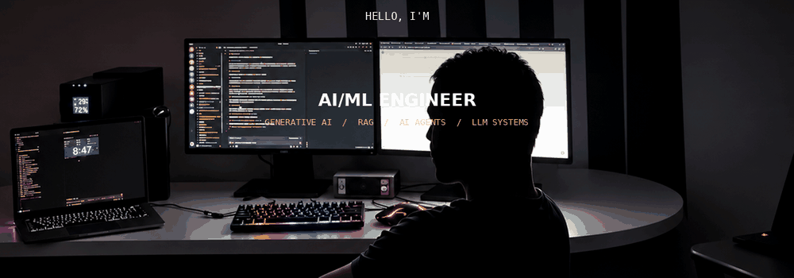

<!-- Animated hero banner: separate Setup.png photo with animated text overlay -->

  

**Generative AI · LLM Systems · Machine Learning**

[LinkedIn](https://linkedin.com/in/j0e9) · [Email](mailto:joepaul72022@gmail.com) · [GitHub](https://github.com/j0E9)

---

## About

AI/ML Engineer with **1.5+ years of experience** building Generative AI and LLM-based systems. I hold a B.Tech in Computer Science & Engineering (AI & ML) and work across model integration, backend APIs, data pipelines and application development.

My current work includes **ChromaDB-based RAG pipelines**, **Exotel-integrated AI calling agents**, and **self-hosted LLM workflows on an NVIDIA DGX Spark server**, keeping company data off external LLM APIs.

I enjoy taking AI systems beyond model experimentation — connecting models, retrieval, tools, APIs and interfaces into useful applications.

## Current Focus

- Retrieval-Augmented Generation (RAG) and semantic search
- LLM agents, tool calling and multi-agent orchestration
- Local LLM deployment and inference workflows
- LoRA / QLoRA fine-tuning with Hugging Face and PEFT
- Backend development with Python and FastAPI
- Machine learning and computer vision

## Technical Skills

| Area | Technologies |
|---|---|
| **Programming** | Python, C++, SQL |
| **Generative AI & LLMs** | RAG Pipelines, AI Agents, Multi-Agent Systems, Tool Calling, LangChain, LangGraph, Prompt Engineering, Conversational AI, Exotel AI Calling Agents, Local LLM Deployment, LLM Evaluation |
| **Fine-Tuning & Inference** | LoRA, QLoRA, PEFT, Hugging Face Transformers, Hugging Face Datasets, Quantization, Inference Optimization, Ollama |
| **Machine Learning** | PyTorch, TensorFlow, scikit-learn, Deep Learning, NLP, Embeddings, Attention Mechanisms, Sentiment Analysis, Speech Recognition, Signal Processing, Feature Engineering |
| **Computer Vision** | OpenCV, YOLO (Ultralytics), EasyOCR, scikit-image |
| **Data & Databases** | PostgreSQL, MySQL, MongoDB, Snowflake, ChromaDB, Semantic Search, ETL, NumPy, Pandas, Excel, Power BI (basic) |
| **Backend & APIs** | FastAPI, Flask, SQLAlchemy, REST APIs, Streamlit |
| **Cloud & DevOps** | AWS (Lambda, S3, ECS, ECR, RDS), Docker (basic), CI/CD, Git, Render |
| **Other Tools** | Unity, Unreal Engine (Blueprints), Blender |

## Professional Experience

### Junior AI Engineer — Codnov.AI, Empire Overseas Education Group
**June 2026 – Present**

- Develop retrieval-augmented generation (RAG) pipelines with ChromaDB to retrieve internal company knowledge and generate context-aware responses.
- Build AI calling agents integrated with Exotel telephony, connecting conversational AI to live calling workflows.
- Deploy and run self-hosted LLMs on the company NVIDIA DGX Spark server, enabling private AI workflows without sending data to external LLM APIs.
- Refine product UIs and reproduce and fix UI and functional bugs to improve application stability.

### ML Engineer — GoFreelab Technologies, Ernakulam, Kerala
**May 2025 – May 2026**

- Built machine learning models, handling work from data preprocessing through training.
- Encoded raw data into embeddings and model-ready features.
- Created vector databases to store and search embeddings for retrieval-based applications.

### Machine Learning Intern — Secneural LLC, Qatar
**May 2024**

- Built an NLP document-parsing pipeline to extract structured data from unstructured and semi-structured files.
- Improved extraction accuracy through iterative model tuning and custom text preprocessing.

## Selected Projects

### Local RAG & AI Agent System
**Python · LangChain · LangGraph · ChromaDB · Ollama**

- Built a fully local RAG pipeline for semantic question answering over documents, with conversational memory.
- Developed LangGraph agent workflows with tool calling, execution loops and state-driven orchestration.
- Engineered conditional routing across specialist workflows for AI, cybersecurity, coding and knowledge tasks.

### Multi-Agent AI Workflow System
**Python · LangGraph · Ollama**

- Designed supervisor, coding and security-analysis agents sharing state in LangGraph to generate, review and refine outputs.
- Reduced inference latency by running quantized Ollama models locally.

### LoRA Fine-Tuning Pipeline
**Python · PyTorch · Hugging Face Transformers · PEFT**

- Implemented LoRA and QLoRA fine-tuning workflows.
- Created instruction-tuning datasets, trained lightweight adapters for domain-specific customization, and built inference pipelines to load and serve them.

### Sahayi — Location-Based Worker Marketplace
**Python · FastAPI · SQLAlchemy · PostgreSQL · geopy · OpenStreetMap · Render**

- Built and deployed a full-stack web application with FastAPI REST APIs, matching local workers with job seekers by geolocation.
- Implemented OTP verification, token payments and real-time notifications.
- Designed worker profiles with skills, media showcases, ratings and bookings.

### News Sentiment Analysis & Dashboard Pipeline
**Python · AWS · PostgreSQL · Streamlit**

- Built an automated ETL pipeline to fetch, process and classify news with sentiment models, storing results in AWS RDS (PostgreSQL).
- Ran the pipeline using AWS services and created Streamlit dashboards showing sentiment trends.

### Floor Plan Material Estimator & Cost Calculator
**Python · YOLO · OpenCV · scikit-image · EasyOCR · NumPy**

- Built a tool to read floor-plan images and estimate construction materials and total cost with brand-level pricing.
- Trained a custom YOLO model to detect structural points; used Canny edge detection and skeletonization to measure wall centerline lengths.
- Automated pixel-to-real-unit scaling, extracted room dimensions with EasyOCR, and generated itemized costing.

### Additional Projects

- **AI-Based Buried-Person Detection Radar Simulator** — physics-based GPR simulation, radar propagation and attenuation modelling, synthetic signal datasets, and ML experiments for weak-echo detection across soil conditions.
- **Voice-Controlled AI Assistant with Face Recognition** — speech recognition, OpenCV face-recognition login, and voice-command automation for file operations, browser, email and mouse control.

## Education

**B.Tech — Computer Science & Engineering (AI & ML)**  
APJ Abdul Kalam Technological University, Kerala · 2021–2025 · CGPA: 6.73

**Higher Secondary (Science)**  
Infant Jesus Senior Secondary School, Aluva · 2019–2021

**Languages:** Malayalam (Native), English (Fluent)

---

## GitHub Activity

**Let's connect and build useful AI systems.**

