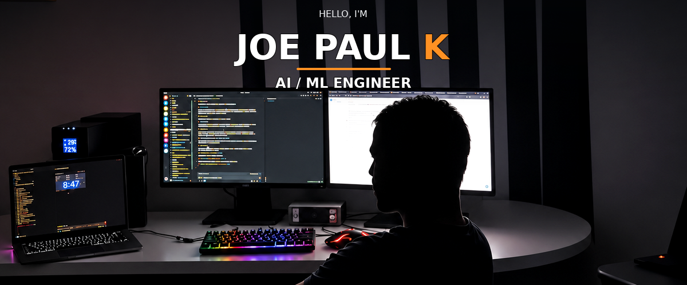

  
    
  
  
  

---

## About me

I'm an **AI/ML Engineer with 1.5+ years of experience** building Generative AI and machine-learning systems. I hold a B.Tech in Computer Science & Engineering (AI & ML) and enjoy taking ideas from experimentation to working applications.

My work spans **RAG pipelines, local LLM deployment, AI agents, model fine-tuning, backend APIs, and computer vision**. I currently work with private, self-hosted LLM workflows on an **NVIDIA DGX Spark**, alongside retrieval systems and Exotel-integrated AI calling agents.

## What I work with

  
    
  
  
  
  
  
  

| Area | Technologies and concepts |
|---|---|
| **Generative AI & LLMs** | RAG, embeddings, semantic search, prompt engineering, tool calling, conversational AI, local LLMs |
| **Agents & orchestration** | LangChain, LangGraph, multi-agent systems, state-driven workflows |
| **Fine-tuning & inference** | LoRA, QLoRA, PEFT, Hugging Face Transformers, quantization, Ollama |
| **Machine learning** | PyTorch, TensorFlow, scikit-learn, NLP, model evaluation, feature engineering |
| **Computer vision** | OpenCV, YOLO, EasyOCR, image processing |
| **Backend & data** | Python, FastAPI, Flask, REST APIs, SQLAlchemy, PostgreSQL, MySQL, MongoDB, ChromaDB |
| **Cloud & engineering** | AWS (Lambda, S3, ECS, ECR, RDS), Docker fundamentals, Git, CI/CD, Render |

## Experience

| Role | Organization | Period |
|---|---|---|
| **Junior AI Engineer** | Codnov.AI · Empire Overseas Education Group | Jun 2026 – Present |
| **ML Engineer** | GoFreelab Technologies | May 2025 – May 2026 |
| **Machine Learning Intern** | Secneural LLC, Qatar | May 2024 |

### Current work

- Building RAG pipelines with ChromaDB for internal knowledge retrieval and context-aware responses.
- Developing AI calling agents integrated with Exotel telephony workflows.
- Running self-hosted LLMs on NVIDIA DGX Spark for private AI workflows.
- Working across model integration, backend APIs, UI refinement, and debugging.

## Selected projects

| Project | What I built |
|---|---|
| **Local RAG & AI Agent System** | A local document question-answering system using LangChain, ChromaDB and Ollama, with conversational memory and LangGraph tool-calling workflows. |
| **Multi-Agent AI Workflow** | Supervisor, coding and security-analysis agents coordinated through shared state and conditional routing in LangGraph. |
| **LoRA / QLoRA Fine-Tuning Pipeline** | Instruction-tuning datasets, PEFT adapters and inference workflows using PyTorch and Hugging Face. |
| **Sahayi — Worker Marketplace** | A deployed FastAPI application connecting local workers and job seekers through geolocation, PostgreSQL, OTP verification and notifications. |
| **Buried-Person Detection Radar Simulator** | A physics-based GPR simulation and ML research project exploring signal propagation, weak-echo detection and model performance across soil conditions. |
| **News Sentiment Pipeline** | An AWS-based ETL workflow using sentiment models, PostgreSQL and a Streamlit dashboard. |
| **Floor Plan Material Estimator** | A computer-vision tool combining YOLO, OpenCV and EasyOCR to estimate construction quantities and costs from floor plans. |
| **Voice-Controlled AI Assistant** | A Python assistant combining speech recognition, face-recognition login and voice-driven desktop automation. |

## Strengths I bring

- **End-to-end thinking:** comfortable connecting models, data, APIs, databases and user-facing applications.
- **Practical LLM engineering:** hands-on work with RAG, local inference, agents, vector databases and fine-tuning.
- **Experimentation and debugging:** iterate on model behavior, investigate failures and improve application reliability.
- **Cross-disciplinary development:** experience across machine learning, NLP, computer vision, signal processing and backend development.
- **Privacy-aware AI:** practical experience running local models and building workflows that keep data within private infrastructure.
- **Learning by building:** turn concepts into working prototypes and continuously deepen the engineering behind them.

## Currently learning and exploring

- Production ML practices, model evaluation and reliable inference.
- LLM systems: retrieval quality, agent orchestration and fine-tuning.
- Local and edge AI deployment, quantization and performance optimization.
- Cloud architecture, containerization and CI/CD.
- Building dependable AI products rather than isolated model demos.

## Education

**B.Tech — Computer Science & Engineering (AI & ML)**  
APJ Abdul Kalam Technological University, Kerala · 2021–2025

**Higher Secondary — Science**  
Infant Jesus Senior Secondary School, Aluva · 2019–2021

---

  <b>Interested in building useful AI systems and learning from strong engineering teams.</b>
   
  <a href="https://www.linkedin.com/in/j0e9">Connect on LinkedIn</a> ·
  <a href="mailto:joepaul72022@gmail.com">Email me</a>

